  <h1>Maher Aladdin Mansour</h1>
  <h3>Founding & Product Engineer | Full-Stack Developer | Next.js · MERN · Expo · Rust</h3>
  
<i>Architecting high-throughput Rust microkernels, scalable Next.js & Expo ecosystems, and white-label SaaS products under <b>Some(CS)</b>.</i>

  <!-- Brand & Social Badges -->
  

    
    
    
    
    
    
  

  

    
    
    
    
    
  

---

## ⚡ Executive Summary

**Founding & Product Engineer** and **Full-Stack Software Engineer** with **5+ years of experience** transforming complex business requirements into high-impact, revenue-generating technical products. 

- 🦀 **Systems & Backend Engineering:** Building dependable architectures with **Node.js** and production-grade **Rust** (`Actix-web`, `Tonic gRPC`), multi-tier caching (`Moka L1`, `Redis L2`), and ACID-compliant databases (`MongoDB`, `PostgreSQL`, `MySQL`).
- 📱 **Cross-Platform Product Delivery:** Shipping high-performance web and mobile ecosystems using **Next.js 16**, **React 19**, **React Native (Expo)**, and **Server-Driven UI (SDUI)** engines.
- 🏢 **Founder @ `Some(CS)`:** Directing the end-to-end engineering lifecycle of white-label SaaS MVPs, commercial CMS platforms, and developer tools at [store.maher-aladdin.me](https://store.maher-aladdin.me), alongside bilingual micro-learning content (**Some(Rust)**).
- ⭐ **Proven Client Execution:** Top-rated freelance engineer on Mostaql with a **100% project success rate**, **5.0★ rating**, **50% client rehire rate**, and **36-minute average response time**.

---

## 🛠️ Technical Arsenal

| Domain | Technologies & Frameworks |
| :--- | :--- |
| **Languages** |     |
| **Frontend & Mobile** |   -000020?style=flat-square&logo=expo&logoColor=white)     |
| **Backend & APIs** |         |
| **Data & Caching** |      |
| **Cloud & DevOps** |         |

---

## 🚀 Flagship Products & Systems

### 🏢 Independent White-Label Products (`Some(CS)`)
* **[EstateStack — White-Label Real Estate Investment Engine](https://store.maher-aladdin.me)** *(08/2026 – Present)*
  * **4-Tier Rust Microkernel:** Trait-based plugin architecture enforcing strict modular contracts across FIDO2 Passkey auth, KYC/AML compliance, and ACID-compliant double-entry multi-currency ledgers in **MongoDB**.
  * **Sub-Millisecond Data Plane:** High-throughput **Actix-web** and **Tonic gRPC** services backed by **Moka L1** in-memory caching and **Redis L2** distributed state.
  * **Server-Driven Ecosystem & BYOL Infra:** Cross-platform **Next.js** (static export) and **React Native (Expo)** apps powered by an SDUI engine and zero-sidebar **React Flow** visual CMS, deployed via single-tenant **Terraform**, **Docker Compose**, CAS vault, and **Traefik** pipelines on **GCP**.
* **[Pro Portfolio — Multilingual Commercial Agency CMS](https://store.maher-aladdin.me)** *(04/2026 – 07/2026)*
  * Commercial portfolio and agency CMS built with **Next.js 16.2**, **TypeScript**, **Tailwind CSS v4**, **Ant Design 6**, and **MongoDB**. Features an inline visual builder, RTL/LTR localization, cryptographic single-seat license verification, and full offline **PWA** support.

### 🌐 Production Client & Open-Source Systems
* **[Arees — Cross-Platform Tourism & Travel Booking App](https://github.com/maheraladdin/arees)** *(01/2025 – 03/2025)*
  * Mobile travel itinerary and booking ecosystem built with **TypeScript**, **React Native**, and **Expo SDK 50**, integrating **Stripe SDK** checkout flows, **Prisma ORM** + **MongoDB**, and localized Arabic interfaces.
* **[Suoq.net — High-Traffic Classifieds & P2P Marketplace](https://maher-aladdin.me)** *(07/2024 – 12/2024)*
  * Architected for **20,000+ active users** with **Next.js**, elastic full-text search, and real-time seller messaging. Reduced API response latency by **70%** via tuned **DigitalOcean** MongoDB clusters and cut dashboard hosting expenditure by **100%** via **Vercel** edge deployment.
* **[Help Them To Reach — Interactive Educational Competition Portal](https://maher-aladdin.me/ar/projects/help-them-to-reach)** *(04/2024 – 06/2024)*
  * Gamified primary-school competition platform in **Next.js**, **TypeScript**, and **MongoDB** with live scoreboards and educator dashboards—awarded **1st Place** in school-level influential experiences (Jeddah, 2024).
* **[Taskify — Collaborative Project Management SaaS](https://github.com/maheraladdin/trello-clone)** | **[Live Demo](https://trello-clone-maheraladdin.vercel.app/)**
  * Multi-tenant Kanban platform built with **Next.js 14 (App Router)**, **Server Actions**, **Prisma ORM**, and **MySQL**, featuring optimistic drag-and-drop boards, workspace audit logs, **Clerk** org auth, and **Stripe** billing.
* **[Video-Chill — End-to-End Type-Safe Streaming Platform](https://github.com/maheraladdin/video-chill)** | **[Live Demo](https://video-chill.vercel.app)**
  * Video sharing platform built on the **T3 Stack** (**Next.js**, **TypeScript**, **tRPC**, **Prisma**, **PlanetScale/MySQL**) with **Cloudinary** adaptive delivery, **TanStack Query**, and **Zustand**.
* **[Discord Clone — Real-Time Voice, Video & Chat Platform](https://github.com/maheraladdin/discord-clone)**
  * Full-stack community platform built with **Next.js (App Router)**, **Socket.io**, **LiveKit WebRTC**, **Prisma ORM**, and **Vercel Postgres** supporting role-based access control and low-latency media rooms.

---

## 💼 Experience Snapshot

- **Indie Product Engineer & Creator** @ **Some(CS) / Gumroad** *(06/2026 – Present)* — End-to-end architecture, deployment, and monetization of self-hosted white-label SaaS products at [store.maher-aladdin.me](https://store.maher-aladdin.me).
- **Founding & Product Engineer (Full-Stack)** @ **Mostaql.com** *(04/2023 – Present)* — Delivering custom web/mobile products across 2-week Agile sprints with a 100% success rate and 50% rehire rate.
- **Information Systems Conscript** @ **Egyptian Armed Forces** *(04/2025 – 06/2026)* — Modernized legacy systems into **TypeScript**, **Next.js**, **Node.js**, and **MongoDB**, digitizing document workflows and automating multi-step approvals.
- **React.js Web Developer Trainee** @ **MCIT — Digital Egypt Pioneers Initiative (DEPI)** *(04/2024 – 10/2024)* — Honored by the Minister of Communications for outstanding performance and technical excellence.

---

## 📜 Licenses & Certifications

| Certification | Issuing Organization | Issued |
| :--- | :--- | :--- |
| **InnovEgypt — Technology Ideation, Innovation Management & Entrepreneurship** | ITIDA & TIEC | Sep 2026 |
| **Sales Foundations Professional Certificate** | National Association of Sales Professionals (NASP) | Sep 2026 |
| **Rust Fundamentals & Data Engineering with Rust** | Duke University (Coursera) | Aug 2026 |
| **Atlassian Agile Project Management Professional Certificate** | Atlassian | Oct 2024 |
| **ReactJS & NodeJS — Build Full E-Commerce RESTful APIs** | Udemy | Oct 2024 |
| **Aha! Product Management Professional Certificate** | Aha! | Sep 2024 |
| **Google AI Professional Certificate** | Google | Jul 2024 |
| **Career Essentials in GitHub Professional Certificate** | GitHub | Jul 2024 |
| **Full-Stack Web Development Professional Nanodegree** | Udacity | Mar 2021 |

---

## 🎓 Education & Honors

- **B.Sc. in Computer Science — Mansoura University** *(Oct 2020 – Jul 2024)* | **Grade:** *Excellent with Honours*
  - 🥇 **Minister of Communications (MCIT) Honor:** Awarded for freelancing and engineering excellence during the Digital Egypt Pioneers Initiative (DEPI).
  - 🏆 **1st Place** — Unity Educational Game Development Competition (Mansoura University, 2022)
  - 🥉 **3rd Place** — Mobile Application Development Competition (Mansoura University, 2023)
  - 🏅 **5th Place** — Natural Language Processing (NLP) & Arabization Competition (Mansoura University, 2024)

---

## 📊 GitHub & Competitive Programming Metrics

  
  

  

